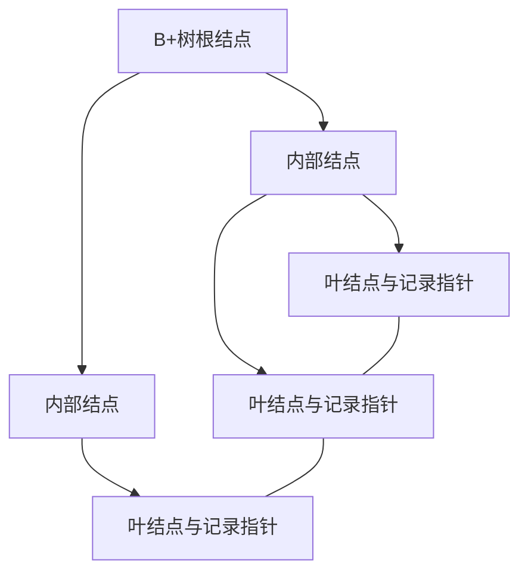

## 定义

::section{#definition slot="knowledge.definition"}

**数据库索引**是一种独立于表记录逻辑顺序的辅助存取结构。它保存从一列或多列生成的索引键到数据记录的定位信息，使DBMS能够通过索引定位记录，而不必总是顺序扫描整张表。

## 结构与代价

::section{#properties slot="knowledge.properties"}

### 索引结构

索引通常可以理解为由索引键和指针组成的有序结构。常见组织方式是$B^+$树：

- 非叶结点保存索引键和指向子结点的指针。
- 叶结点保存索引键以及指向记录的指针或主键值。
- 叶结点按索引键顺序链接，便于范围扫描。

“$B^+$”中的$B$通常指平衡（balanced），而不是二叉搜索树。所有叶结点位于同一深度，因此插入、删除后仍能保持较稳定的查找代价。



### 聚集与非聚集索引

**聚集索引**使数据记录的逻辑顺序或物理组织与索引键顺序一致。一个表通常只能有一个聚集索引。InnoDB以主键构造聚簇索引，叶结点中的数据记录直接按主键组织。

**非聚集索引**与数据记录的物理顺序没有直接关系，叶结点保存索引键和定位值。InnoDB的辅助索引通常保存对应主键值，再通过主键回到聚簇索引取得完整记录。

### 索引分类

索引还可以按列数分为单列索引和复合索引；按约束作用分为普通索引和唯一索引；按存储方式分为$B^+$树索引、$\mathrm{Hash}$索引等。复合索引的字段顺序影响匹配条件，查询通常需要从前缀开始使用索引列。

### 访问代价

索引能减少满足高选择性条件的记录扫描，并可为连接、排序和分组提供有序访问路径。索引不是免费加速器：它会占用额外存储空间，每次插入、删除或修改索引列时都要同步维护相应索引。

## 使用原则

- 优先为查询频繁且更新较少的字段建立索引。
- 数据量大、单次查询命中比例低时更能体现索引收益。
- 为连接、排序和分组常用的字段考虑索引。
- 低选择性字段的普通$B^+$树索引可能收益很低。
- 复合索引应按照主要查询条件设计字段顺序。
- 索引创建后应监控实际使用情况，删除长期未使用的索引。

MySQL可以在查询前使用`EXPLAIN`查看访问计划。`type=ALL`通常表示全表扫描，但索引是否有效还取决于选择度、返回列、过滤条件和优化器估计，不能只凭某一个字段机械判断性能。

## 创建与删除示例

::section{#examples slot="knowledge.examples"}

```sql
CREATE INDEX idx_sname ON student (sname);

CREATE INDEX idx_sbirth_ssex
ON student (sbirth ASC, ssex DESC);

CREATE UNIQUE INDEX idx_tname_dno
ON teacher (tname, dno);
```

```sql
DROP INDEX idx_sname ON student;
```

## 约束与索引

主键和唯一约束通常由DBMS自动建立对应索引。唯一索引拒绝重复的非空索引值，但具体允许出现多少个空值取决于DBMS。

