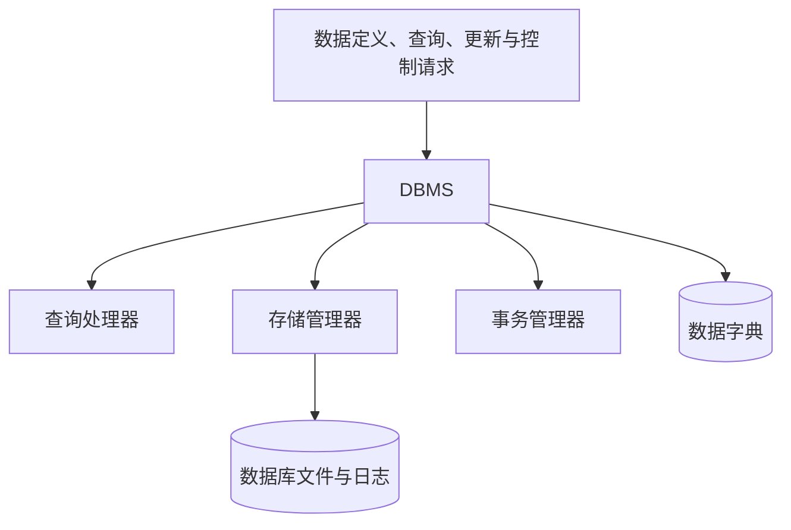

数据库管理系统位于用户、应用程序与操作系统之间，是数据库系统的核心软件。数据库能否被定义、访问、共享和保护，主要由DBMS提供。

## 定义

::section{#definition slot="knowledge.definition"}

**数据库管理系统（Database Management System，DBMS）** 是专门用于定义、操纵、管理和维护数据库的大型系统软件。

用户和应用程序通常不直接操作数据文件，而是向DBMS提交数据定义、查询、更新和控制请求。DBMS解释这些请求，访问数据库并返回结果，因此它是用户与数据库之间的软件接口，也是数据库系统的核心组成部分。

## 主要功能

1. **数据定义**：定义数据库、表、视图、索引、约束以及其他数据对象。
2. **数据操纵**：执行数据检索、插入、修改和删除。
3. **数据库运行管理**：实施安全性控制、完整性控制、并发控制和数据恢复。
4. **数据组织、存储和管理**：决定数据的物理组织、文件结构与存取路径。
5. **数据库建立与维护**：完成初始装载、转储、恢复、重组和重构等维护工作。

这些功能共同支撑数据共享与受控访问。性能、安全性和恢复能力并非由某一个功能单独决定，而取决于DBMS如何处理存储、并发、日志和权限。

## 内部组成

DBMS通常包含查询处理器、存储管理器、事务管理器和数据字典等部分。

查询处理器负责分析、检查和执行数据请求；存储管理器负责数据、索引与缓冲区的组织；事务管理器负责并发控制和恢复；数据字典保存数据库对象及其定义信息。具体模块划分随产品实现变化，但这些职责需要由DBMS共同承担。

## 常见DBMS

::section{#examples slot="knowledge.examples"}

- MySQL是常见开源关系数据库，InnoDB是其默认事务存储引擎。
- PostgreSQL是功能完善的开源对象关系数据库，许多数据库产品以其为基础扩展。
- openGauss是基于PostgreSQL深度开发的开源数据库。
- Oracle是大型商业关系数据库，常用于对性能、管理和高可用要求较高的系统。
- SQL Server和SQLite采用不同的产品定位、许可方式和运行环境。

## 选型考虑

选择DBMS需要综合数据模型、事务要求、数据规模、并发量、生态、许可和运维成本。产品名称本身不能代替选型评估，同一产品在不同版本、部署方式和配置下也可能呈现不同能力。
