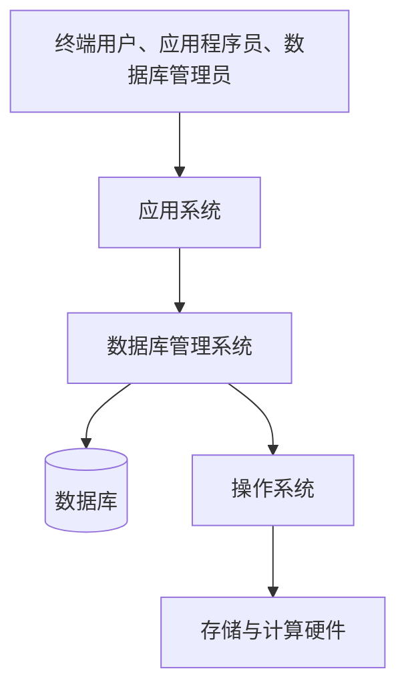

数据库系统不是一个孤立的数据库文件，而是数据库、DBMS、应用、硬件、操作系统和用户共同构成的完整信息系统。

## 定义

::section{#definition slot="knowledge.definition"}

**数据库系统（Database System，DBS）** 是在计算机系统中引入数据库后形成的完整信息系统。它不只包含数据库，还包括数据库管理系统、应用系统、计算机硬件、操作系统和各类用户。

### 组成与用户职责

数据库保存业务数据，DBMS负责管理数据，应用系统承载业务逻辑，计算机硬件和操作系统提供运行环境。

- **终端用户**通过应用系统提供、查询或使用数据。
- **应用程序员**开发并部署访问数据库的应用程序。
- **数据库管理员**参与数据库结构设计，负责运行监控、安全、备份恢复、性能改进和使用支持。

这些组成和角色决定数据库系统能够连接业务使用与底层数据管理。数据库本身只是数据集合，离开DBMS、应用和运行环境便不能独立承担完整信息系统的职责。

## 外部体系结构

外部体系结构描述用户应用与数据库之间的部署关系，常用的分类包括：

- 单用户结构：一个用户独占使用数据库系统。
- 主从式结构：一台主机管理数据库，多个终端连接主机。
- 分布式结构：数据和计算分布在多个节点上，通过网络形成一个逻辑整体。
- 客户机/服务器（C/S）结构：客户端处理用户交互和部分业务，服务器集中管理数据库。
- 浏览器/服务器（B/S）结构：浏览器作为客户端，通过Web应用访问数据库。

外部体系结构描述部署方式，不等于数据库内部的三级模式结构。改变客户端连接方式不会自动改变外模式、模式和内模式的定义。

数据库系统内部如何组织模式，再由三级模式和两层映像描述并保障数据独立性。

