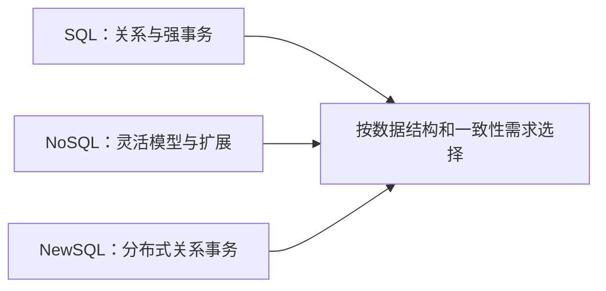

## 定义

::section{#definition slot="knowledge.definition"}

关系数据库并不是数据管理的唯一形态。数据规模、结构稳定性、事务要求和可用性目标会推动系统选择不同的数据模型与部署方式。

### 三类系统的关注点

**SQL数据库**以关系模型和SQL为主要接口，通常具有严格模式、连接查询和ACID事务能力，适合结构稳定、需要强一致性的业务数据。

**NoSQL数据库**覆盖键值、文档、列族、图等多种模型。它们常用较灵活的数据结构，并通过分区、复制和特定一致性选项换取扩展性与可用性，适合半结构化或大规模数据。

**NewSQL数据库**保留关系模型和事务语义，同时通过分布式架构提升水平扩展能力。其目标是在关系型事务和分布式规模之间取得新的工程平衡。

NoSQL不必然等于“最终一致”，NewSQL也不等于在所有节点上免费获得无限扩展。实际一致性、延迟和可用性由复制协议、分区方式与配置共同决定。

## 分布式数据库

::section{#distributed}

分布式数据库把数据和计算分布到多个物理节点，通过网络形成逻辑整体。它主要应对：

- 单机存储容量不足；
- 高并发访问与吞吐压力；
- 节点或网络故障下的高可用需求；
- 跨地域访问时延与数据放置要求。

分布式能力会引入分区键设计、跨节点查询、事务协调、复制延迟和一致性选择等新问题。简单地增加节点不能替代良好的数据模型和访问路径。

## 与其他数据平台的关系

::section{#ecosystem}

数据仓库面向主题、集成、相对稳定并保留历史变化，适合在线分析处理（OLAP）、报表和决策支持。

数据湖集中保存多种原始和转换数据，支持结构化、半结构化和非结构化内容，适合探索分析、机器学习和大数据处理。若缺少目录、质量和治理，集中存储并不能自动形成可靠的数据资产。

事务数据库、数据仓库和数据湖可以组成分层数据平台。数据库负责在线事务，数据仓库承载一致的分析模型，数据湖保存更广泛的原始与实验数据，并通过清晰的数据流转和质量控制连接。

