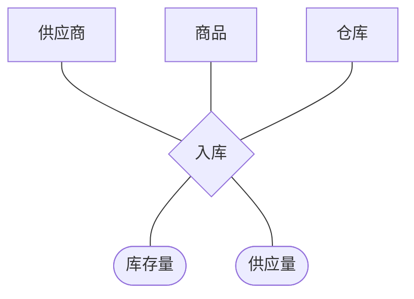

## 定义

::section{#definition slot="knowledge.definition"}

联系描述不同类实体之间的相互关联。只有需要记录新信息的关联才应在数据模型中显式建立联系。

### 映射基数

映射基数描述一个实体通过联系能够与另一实体集中的多少个实体相关联。

- **一对一（$1:1$）**：双方各有一个实体与对方至多一个实体关联。
- **一对多（$1:n$）**：$A$中一个实体可以关联$B$中多个实体，$B$中一个实体至多关联$A$中一个实体。
- **多对多（$m:n$）**：双方的一个实体都可以与对方多个实体关联。

```mermaid
erDiagram
  STUDENT }o--o{ COURSE : 选修
  CLASS ||--o{ STUDENT : 包含
  INVOICE ||--|| SALES_ORDER : 结算
```

### 联系属性

联系产生的信息若只属于该次关联，应作为联系属性。例如学生与课程之间的“选修”联系产生成绩，成绩既不属于学生，也不属于课程，应放在联系上。

联系可以不带属性，但设计时仍应检查是否存在遗漏的业务信息。不能把实体的普通属性，尤其实体主键，错误地复制为联系属性；主键通过参与联系的实体来表达。

### 联系键

二元联系键通常由映射基数决定：

- $1:1$联系可选择任一方实体的主键作为候选键。
- $1:n$联系使用“多”方实体的主键作为主键。
- $m:n$联系使用参与双方实体主键的组合作为主键。

多值联系无法仅依靠两个实体的主键区分每一次发生，通常还需要时序、批次等属性参与标识。

### 三元与多值联系

**三元联系**同时连接三个实体集，不能简单等价为三个二元联系。三元联系能表达必须由三个实体共同产生的事实，例如供应商、商品和仓库共同形成一次入库记录。

**多联系**指同一组实体之间存在多种语义不同的联系。联系较多时可以合并相近关系并用联系属性或类型区别，但前提是合并后不损失业务含义。

**多值联系**指同一对实体之间可能重复发生多次关联。它必然是多对多联系，并通常具有日期、阶段等能够区分每次发生的属性。



当三元联系较难理解或难以确定映射基数时，可以引入弱实体表示一次共同发生，再分别建立三个二元联系。是否转换取决于表达清晰度和后续关系模式的需要，不能把所有三元联系机械拆分。

