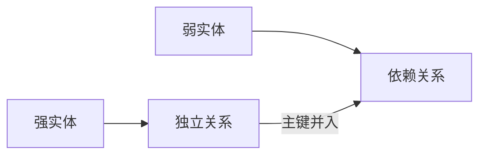

## 定义

::section{#definition slot="knowledge.definition"}

**E-R模型到关系模式的转换**是逻辑结构设计的一部分：把实体、属性和联系按照规则映射为关系模式，并确定相应的键与约束。转换首先保证实体和联系都有承载位置，再检查主键、外键与冗余。

## 实体转换

一个强实体转换为一个关系：实体属性成为关系属性，实体名称成为关系名，实体键成为关系键。

复合属性拆成其子属性。多值属性不应在一行中保存多个值，而应先转换为弱实体，再随弱实体转换。

## 弱实体转换

::section{#weak}

弱实体对应关系包含：

- 弱实体自身属性；
- 依赖强实体的主键属性；
- 弱实体部分键。

若部分键只在强实体范围内唯一，主键由“强实体主键 + 部分键”组成。若部分键已经全局唯一，可以用部分键作主键，但强实体主键仍作为外键保留。

## 联系转换

::section{#relationships}

普通二元联系的转换规则为：

- **$1:1$**：两个实体的主键都可以作为候选键。
- **$1:n$**：使用$n$端实体的主键作为联系关系的主键。
- **$m:n$**：使用参与双方主键的组合作为主键。

联系的附加属性与参与实体的主键一起进入联系关系。三元联系转换时，所有参与实体主键与联系属性进入一个关系，主键通常由三个实体主键组合。

多值联系通常先建模为弱实体，再转换成包含相关实体主键、部分键和联系属性的关系。若直接转换，也必须加入能够区分每次联系发生的动态属性。

## 整理转换结果

::section{#cleanup}

- 主键相同的多个关系可以评估是否合并，以减少连接。
- 属性过多的关系可以按使用频率垂直拆分。
- 主键字段过多的关系可以引入稳定单字段键，同时保留原候选键的唯一约束。
- 检查多值属性、部分依赖、传递依赖以及冗余联系。

转换得到的模式集合还要进行规范化。能够转换为关系并不等于设计已经良好；数据冗余和异常需要在范式分析与模式评价中继续处理。

