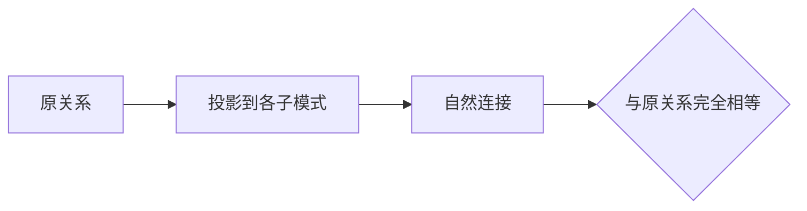

## 定义

::section{#definition slot="knowledge.definition"}

规范化会把一个关系模式分成多个子模式。良好的分解应能在不丢失信息的前提下重建原关系，并尽可能保留原函数依赖。

### 无损连接

设关系模式$R$分解为$R_1,R_2,\dots,R_k$。对每个满足原函数依赖集的合法关系实例$r$，若

$$
\Pi_{R_1}(r)\bowtie
\Pi_{R_2}(r)\bowtie\cdots\bowtie
\Pi_{R_k}(r)=r,
$$

则分解是无损连接分解。自然连接后既不能缺少原元组，也不能凭空产生虚假元组。

## 判定性质

::section{#decomposition-properties slot="knowledge.properties"}

### 二分分解判定

若$R$分解为$R_1$和$R_2$，则该分解是无损连接的充分必要条件为：

$$
(R_1\cap R_2)\to R_1
\quad\text{或}\quad
(R_1\cap R_2)\to R_2
$$

属于$F^+$。

例如$R(A,B,C)$，$F=\{A\to B,B\to C\}$，分解为$R_1(A,B)$、$R_2(B,C)$。公共属性为$B$，且$B\to BC$，所以分解是无损连接分解。若分解为$R_1(A,B)$、$R_2(A,C)$，公共属性为$A$，虽然$A\to AB$，因此二分解本身也是无损的；但还需单独判断它是否保持全部函数依赖。

### 通用表格测试

对于多子模式分解，可以构造一张表：

1. 行对应每个$R_i$，列对应原关系属性$A_j$。
2. 若$A_j\in R_i$，单元格写$a_j$；否则写$b_{ij}$。
3. 对每个函数依赖$X\to Y$，找出$X$各列取值相同的行。
4. 若这些行在$Y$的某列中已有$a$型符号，则把所有相关行改为该$a$型符号；若没有，则统一改为行号最小的$b$型符号。
5. 反复扫描函数依赖，直到表格不再变化。
6. 若存在某一行的所有单元格都是$a$型符号，则分解无损连接；否则有损。

通用表格法适用于三个及以上子模式；只有两个子模式时，直接检查公共属性能否决定其中一个子模式。扫描必须持续到单元格不再变化，因为处理一个函数依赖后，可能使另一个依赖第一次满足更新条件。修复过程中，$a$型符号不能被普通$b$型符号覆盖。

### 保持函数依赖

函数依赖集$F$在子模式$R_i$上的投影$F_i$包含闭包$F^+$中所有只涉及$R_i$属性的函数依赖。

若

$$
(F_1\cup F_2\cup\cdots\cup F_k)^+=F^+,
$$

则分解保持函数依赖。直观上，只检查各子关系就能判断原模式中的全部函数依赖，而不必先做连接。

无损连接和保持依赖是两个独立目标。一个分解可能无损但不保持依赖，也可能保持依赖但一般不能只凭这一性质保证无损，因此规范化时必须分别检查。

## 证明

::section{#binary-proof slot="knowledge.proof"}

记二元分解的公共属性为$C=R_1\cap R_2$。

若$C\to R_1$或$C\to R_2$属于$F^+$，则公共属性能够决定其中一个子模式。对$R_1$和$R_2$中公共属性相同的元组，被决定一侧的属性值已经由$C$唯一确定，因此连接不会产生原关系之外的元组，也不会丢失原元组，所以分解无损。

反过来，若分解无损而$C$不能决定$R_1$或$R_2$，可以构造两个满足全部函数依赖的元组：它们在$C$上相同，却分别在$R_1\setminus R_2$或$R_2\setminus R_1$上保存不同值。投影后再连接会组合出原关系不存在的元组，与无损连接矛盾。因此二元分解无损时，至少有一个方向满足$C\to R_1$或$C\to R_2$。

