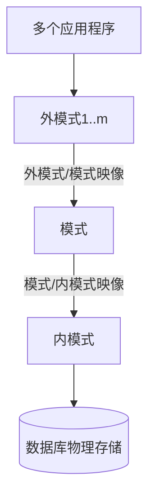

数据库系统从内部结构看分为三级模式，并通过两层映像把用户视图、全局逻辑结构和物理存储结构连接起来。

## 三级模式

::section{#definition slot="knowledge.definition"}

**外模式**又称用户模式或子模式，是某一应用或用户能够看到的局部数据的逻辑结构与特征。一个数据库可以定义多个外模式。

**模式**又称概念模式，是数据库中全体数据的全局逻辑结构与特征描述。一个数据库只有一个模式，模式设计是数据库设计的核心任务之一。

**内模式**又称存储模式，描述数据的物理存储结构、记录组织、索引方式和存取路径。一个数据库只有一个内模式。

## 两层映像与独立性

::section{#properties slot="knowledge.properties"}

外模式/模式映像规定局部逻辑结构与全局逻辑结构之间的对应关系。当模式发生变化时，可以调整映像而保持外模式不变，使应用程序不必随之改写。这种性质称为**逻辑独立性**。

模式/内模式映像规定全局逻辑结构与物理存储结构之间的对应关系。当存储方式、文件组织或索引结构变化时，可以调整映像而保持模式不变。这种性质称为**物理独立性**。

> [!NOTE]
> 逻辑独立性保护外模式和应用程序免受全局逻辑结构变化的影响；物理独立性保护模式和应用程序免受存储结构变化的影响。

## 三级结构的作用

::section{#benefits}

- 用外模式隔离不同应用可见的数据范围。
- 用模式维护全局一致的数据结构。
- 用内模式允许DBMS独立选择物理存储和存取方法。
- 通过两层映像减少数据结构变化对上层应用的影响。

三级模式描述数据库的内部组织，外部体系结构描述应用如何连接到数据库。C/S、B/S、分布式等属于部署结构，不能与三级模式混为一谈。

