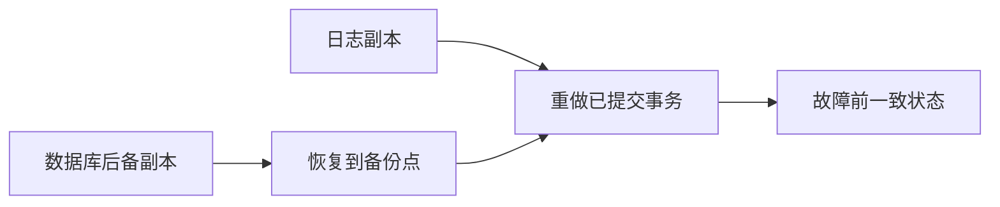

数据库恢复依赖冗余信息。日志记录事务引起的数据变化，恢复程序根据事务是否完成决定撤销或重做，使数据库回到一致状态。

## 定义

::section{#definition slot="knowledge.definition"}

事务是用户定义的一组数据库操作，是并发控制和恢复的基本工作单位。

事务以`START TRANSACTION`或等价语句开始，通过`COMMIT`提交，通过`ROLLBACK`撤销。MySQL默认自动提交单条语句；需要把多条语句作为一个事务时，必须显式控制事务边界。

## 事务性质

::section{#properties slot="knowledge.properties"}

- **原子性**：事务中的操作要么全部完成，要么全部不产生效果。
- **一致性**：事务把数据库从一个一致状态变为另一个一致状态。
- **隔离性**：并发事务互相不可见未授权的中间结果。
- **持久性**：事务一旦提交，其结果应长期保留。

## 事务边界示例

::section{#examples slot="knowledge.examples"}

下面的转账事务把扣款和入款放在同一事务中；只有两条更新都成功并提交后，改动才成为持久结果：

```sql
START TRANSACTION;
UPDATE account SET balance = balance - 100
WHERE account_no = 'A';
UPDATE account SET balance = balance + 100
WHERE account_no = 'B';
COMMIT;
```

## 日志

日志通常按发生顺序追加记录：

- `<Ti, START>`：事务$T_i$开始。
- `<Ti, A, V_1, V_2>`：事务$T_i$把数据项$A$从旧值$V_1$改为新值$V_2$。
- `<Ti, COMMIT>`：事务提交。
- `<Ti, ABORT>`：事务中止。

**UNDO**从日志尾部向头部处理未完成事务，把数据恢复为旧值，保证原子性。**REDO**从日志头部向尾部处理已提交事务，把数据重新设为新值，保证持久性。

## 故障与恢复

**事务故障**是单个事务未能正常完成。系统反向扫描日志，对该事务执行UNDO，通常自动完成。

**系统故障**使运行中的事务中断，但磁盘数据通常仍在。恢复时分别把已提交事务和未提交事务加入REDO与UNDO队列。

**介质故障**造成磁盘数据全部或部分丢失。恢复时先装入后备副本，再用日志副本重做备份点之后已经提交的事务。


