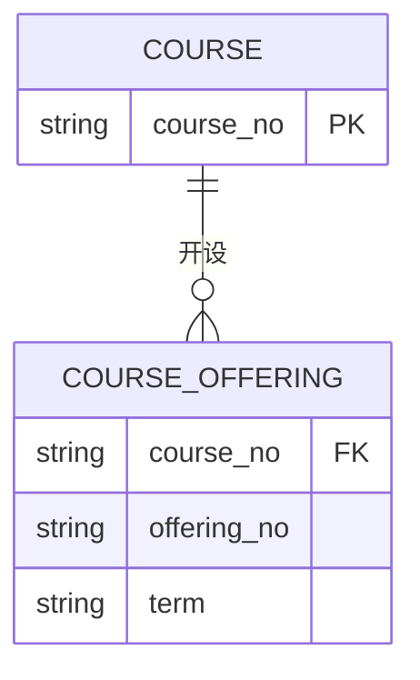

弱实体不能仅依靠自身属性独立标识，它的存在依赖某个强实体。弱实体把依附关系中的局部对象从普通属性或复杂联系中分离出来。

## 定义

::section{#definition slot="knowledge.definition"}

若实体B的存在以实体A的存在为前提，并且B自身没有能够独立标识实体的完整候选键，则B可以建模为依赖于A的弱实体。A与B之间通常是一对多的标识关系。

**部分键**是弱实体自身用于区分的属性集合。弱实体的全局标识由强实体主键与部分键共同组成。

在E-R图中，弱实体常用双矩形表示，部分键用虚下划线表示。若部分键在业务上实际上已经全局唯一，可以按普通实体处理，但仍要用外键保留与强实体的联系。

## 常见用途

::section{#uses}

- 把多值属性转换为弱实体。例如一个学生可以有多个联系电话，电话类别可作为部分键。
- 把多值联系转换为弱实体。引入日期、项目或阶段作为部分键，以区分同一对实体之间的多次联系。
- 把三元联系转换为弱实体加多个二元联系，使每次共同发生可以拥有独立身份。
- 把“实体与联系之间的联系”转换为弱实体，例如先把“开课”从联系转为“开课班”实体，再让学生选修开课班。

## 标识与转换

::section{#transformation}

转换关系模式时，弱实体对应关系的属性包括强实体主键、弱实体自身属性和部分键。若部分键仅在强实体范围内唯一，主键由强实体主键与部分键组合；若部分键全局唯一，可以用部分键作主键，并把强实体主键保留为外键。

弱实体不是“没有键”的实体。它必须有能够与强实体主键共同完成标识的部分键，否则无法区分同一强实体下的多个弱实体。

